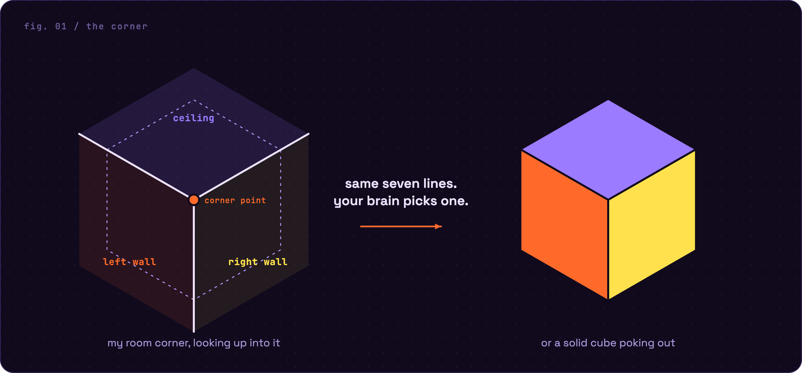
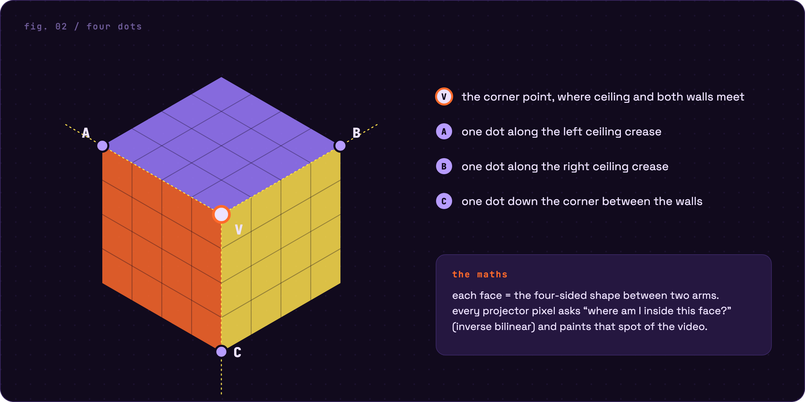
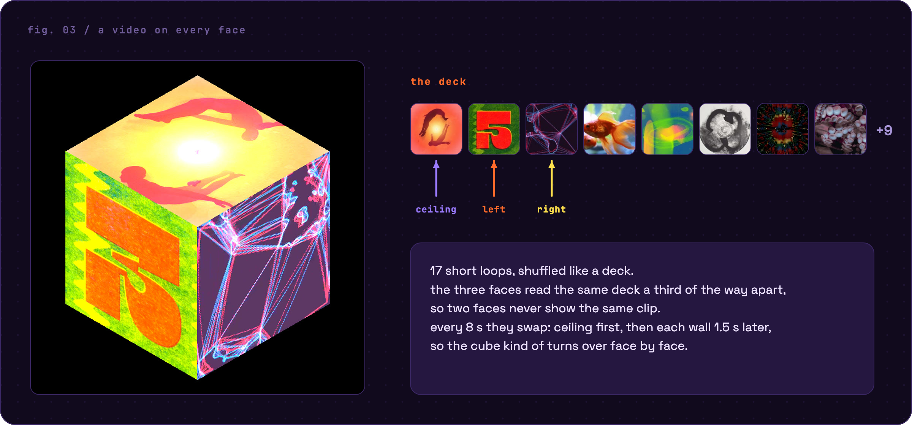
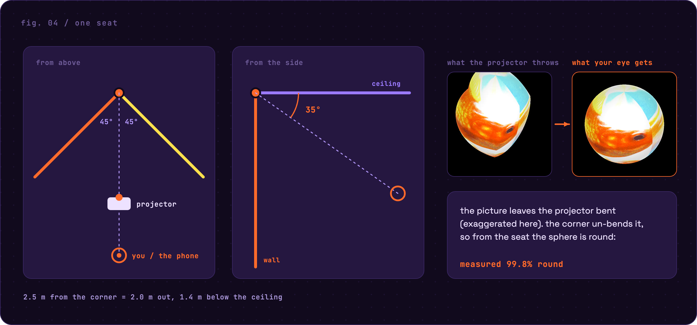
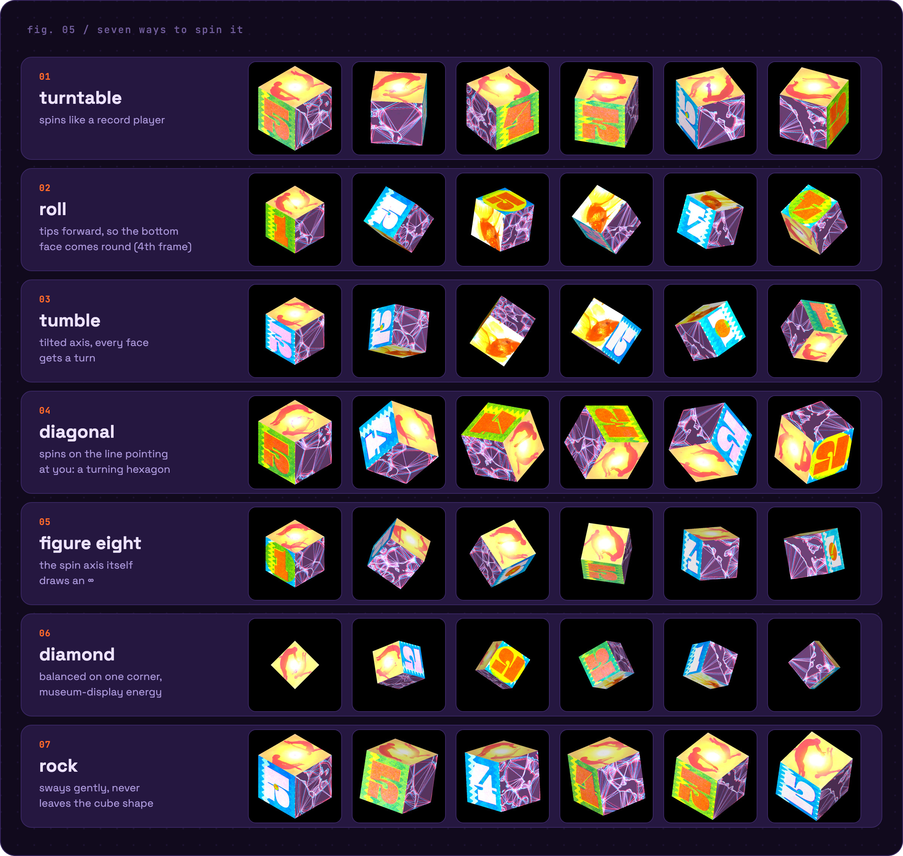
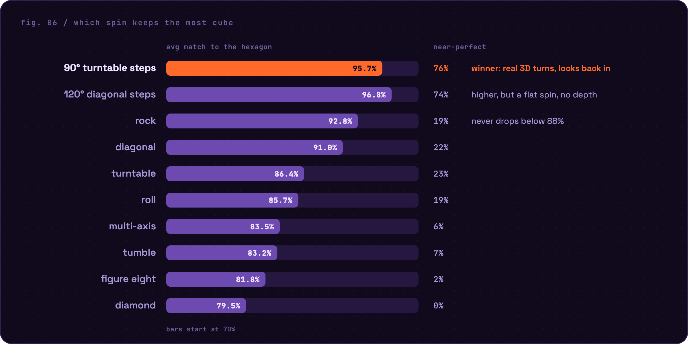
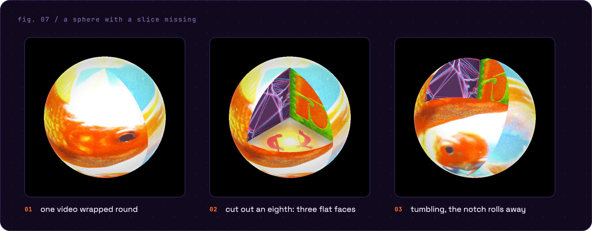

# Projection Mapping Isometric Cubes & Shapes in the Corner of My Room

<p align="center"></p>

I pointed a small home projector at the corner of my bedroom, right where the ceiling meets two
walls, and turned it into a cube. It sits in the corner, plays a different video on every face,
and turns on its own. From the right seat it honestly looks like a solid object hanging there.

Built in **TouchDesigner** with GLSL shaders and a bit of Python, mostly between midnight and 3am.
Runs at 60 FPS on an M4 MacBook Air through a cheap 720p projector.

<!-- full video goes here: drag corner-cube-video.mp4 into this spot in GitHub's editor -->

---

## How it works

### The corner is already half a cube
Every room corner is the inside of a box: three flat surfaces meeting at 90°. When the three
faces look the same size, your eyes can't tell an inside corner from the outside corner of a
cube. That's the Necker cube illusion, and the whole project runs on it.



### Four dots line it up
One dot on the corner, one dot along each crease. The three faces get built from those four
dots, so their edges sit on the real creases and can't drift apart.


code: [`shaders/cube_rig.frag`](shaders/cube_rig.frag)

### A video on every face

code: [`scripts/shuffle_deck.py`](scripts/shuffle_deck.py), [`shaders/face.frag`](shaders/face.frag)

### It only works from one seat
A projected illusion has one sweet spot. Film from there and it looks like a real object.
From anywhere else it looks bent, which is kinda the point.

The four dots tell me how the three surfaces look to the projector. From the seat, those same
faces look like a perfect isometric hexagon. So every object gets drawn in that perfect "seat
view" first, then each projector pixel works out which surface it lands on and where, and copies
the matching spot. That's anamorphic projection.



### Making it spin
Once the cube can float, it can turn. A small Python "motion engine" works out the cube's 3D
orientation every frame and hands it to the shader, so any spin is just a formula. The cube is a
real 3D box with all six faces, including a bottom face with its own video, drawn through the same
seat-corrected view. When a turn lands on a quarter turn it snaps back onto the real creases.



| turntable | roll (shows the bottom) | tumble | diagonal |
|:-:|:-:|:-:|:-:|
|  |  |  |  |
| **figure eight** | **diamond** | **rock** | |
|  |  |  | |

code: [`scripts/spin_rot.py`](scripts/spin_rot.py), [`shaders/cube_spin.frag`](shaders/cube_spin.frag)

### Picking the best spin, with numbers
I wanted the rotation that keeps the most "cube", so I simulated every motion for 2 minutes and
compared its outline with the perfect isometric hexagon, frame by frame.



The winner is what's running in the video: hold for 4 seconds locked into the corner, turn 90°
in 3 seconds, lock back in. Both simulators are in the repo and run with plain Python:
[`scripts/iso_lab.py`](scripts/iso_lab.py) (how isometric each spin stays) and
[`scripts/axis_lab.py`](scripts/axis_lab.py) (smoothness, jumps, faces seen).

### Bonus: a sphere with a slice missing
A cube changes outline as it spins. A sphere is always a circle, so it tumbles smoother. Cut out
an eighth and three flat faces show up inside, meeting at 90° just like the ceiling and two walls.
A tiny room corner, projected into the real one.


code: [`shaders/sphere_cut.frag`](shaders/sphere_cut.frag)

---

## The parts

| | |
|---|---|
| projector | HY300, 1280×720, roughly 150 to 260 lumens. A dark room matters way more than a bright projector. |
| computer | M4 MacBook Air |
| software | TouchDesigner 2025 (Non-Commercial, which caps images at 1280 px, same as the projector) |

## What's in here

```
shaders/   GLSL: the 4-point cube rig, the spinning 3D cube, the cut sphere, per-face look
scripts/   Python from inside TouchDesigner (motion engine, shuffle deck, kick sync) + the two simulators
docs/      BUILD-LOG.md (research and every decision along the way), img/ (the figures),
           make_diagrams.py (rebuilds the figures from the same geometry the piece uses)
```

The shaders and scripts are copied out of the TouchDesigner project so they can be read here. The
`.toe` itself isn't included, and paths in the scripts point at my local `~/TD-Lab` folder.

## Things I learned

I wanted every face edge to edge with zero gaps, and eyeballing it didn't get me there. There were
three separate causes: borders baked into the GIFs, a seam I'd added on purpose and forgot about,
and a one-pixel seam where the graphics card blended each face's last pixel with black. Only
measuring the pixels along every crease found that last one.

The corner does the calibration for you. Three creases meeting at a point is already a 3D axis,
so four points are enough to describe the whole surface.

A projector can't make black, it can only add light. A dark room and mostly dark pictures do more
than brightness ever will, and two neighbouring walls lit bright at the same time just bounce light
into each other and wash out.

## Next

- Minecraft blocks. A Minecraft block is literally a cube with a top, sides and a bottom, which
  is exactly what this rig has. Scroll through them like a hotbar and watch each one turn in the
  corner, and roll it over to see sides you've never looked at, like the bottom of a crafting table.
- Music that actually feels right. I tried making the cube punch bigger on every kick drum and
  didn't like it. The kick detection works (it's in [`scripts/kick_sync.py`](scripts/kick_sync.py)),
  I just haven't found the reaction yet.
- Hand tracking with MediaPipe, so a swipe in the air spins the cube faster.
- Smoother turns. Tune the easing and blend between axes, using the simulators to measure each try.

## Credits

The video loops on the faces are reference GIFs I collected online. They're not in this repo and
remain their creators' work; any square video loops will play. The inverse-bilinear face mapping
is based on Inigo Quilez's `invBilinear`. Fonts in the figures: Space Grotesk and JetBrains Mono
(SIL Open Font License).
