# Projection Mapping Isometric Cubes & Shapes in the Corner of My Room

<p align="center">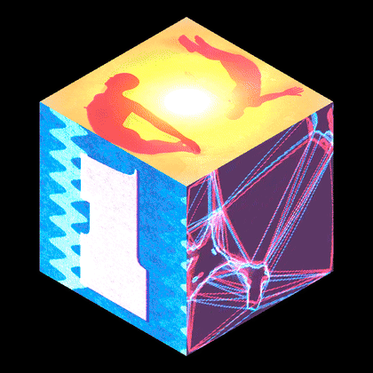</p>

I pointed a small home projector at the corner of my bedroom, where the ceiling meets two walls,
and turned it into a cube that sits in the corner, plays a different video on every face,
spins, and punches to the kick drum. From the right seat it looks like a solid object hanging
there. Built in **TouchDesigner**, with GLSL shaders and a little Python.

Runs at 60 FPS on an M4 MacBook Air through a cheap 720p projector.

---

## How it works, in eight pictures

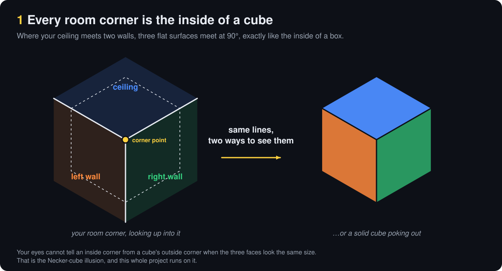

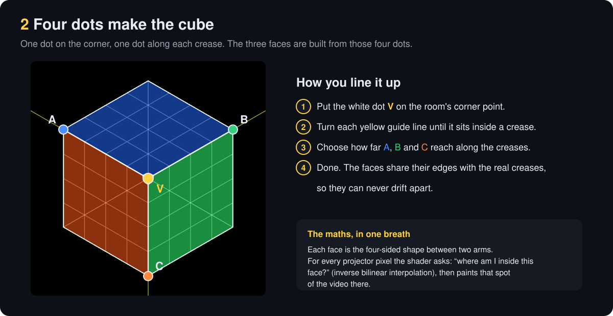
Code: [`shaders/cube_rig.frag`](shaders/cube_rig.frag)

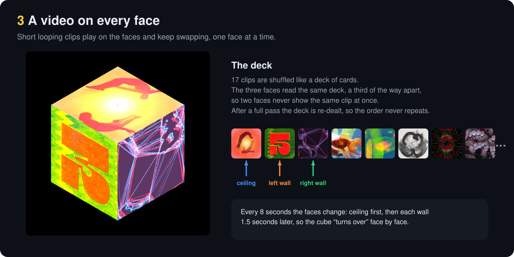
Code: [`scripts/shuffle_deck.py`](scripts/shuffle_deck.py), [`shaders/face.frag`](shaders/face.frag)

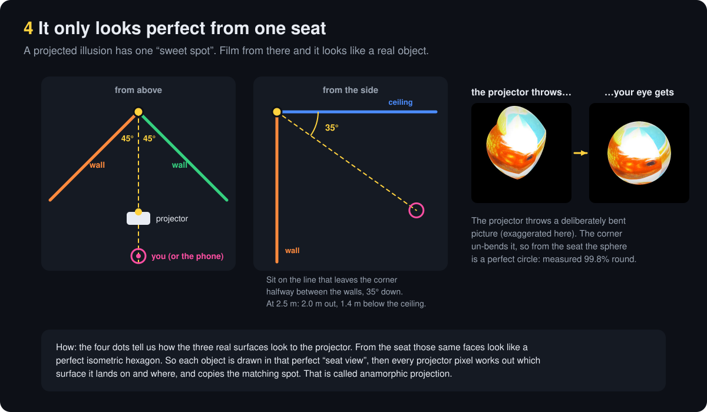

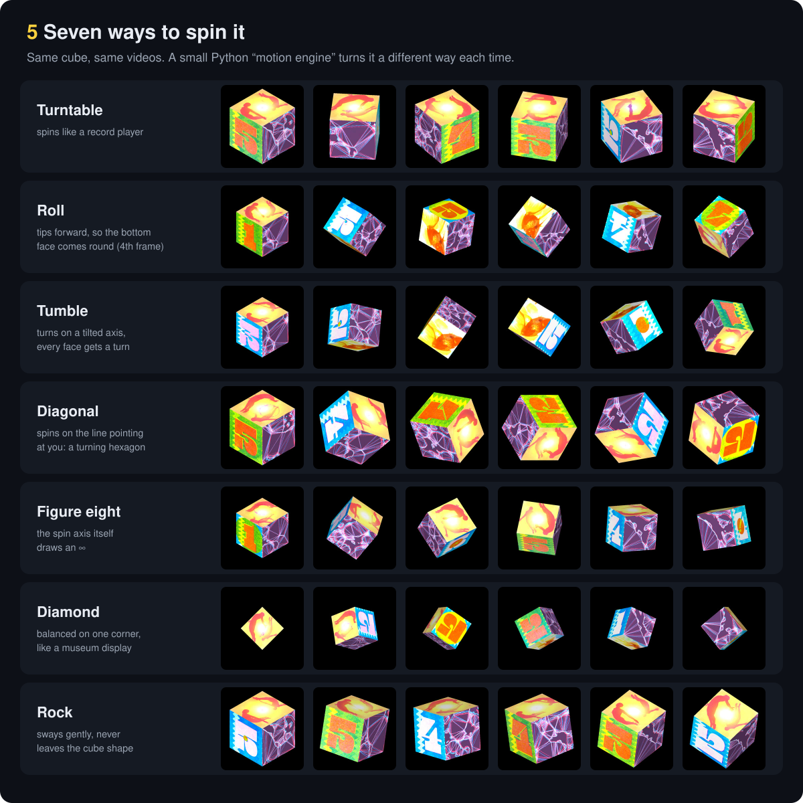
Once the cube can float, it can turn. A small Python “motion engine” works out the cube's
3D orientation every frame and hands it to the shader, so any spin is just a formula.
The cube is a real 3D box (all six faces, including a bottom face with its own video), drawn
through the same seat-corrected view, so when a turn lands on a quarter turn it snaps back
onto the real creases.

| Turntable | Roll (shows the bottom) | Tumble | Diagonal |
|:-:|:-:|:-:|:-:|
| 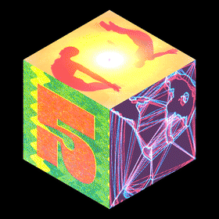 | 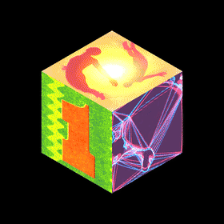 | 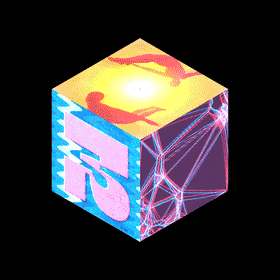 | 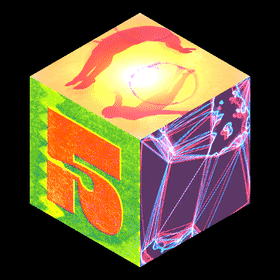 |
| **Figure eight** | **Diamond** | **Rock** | |
| 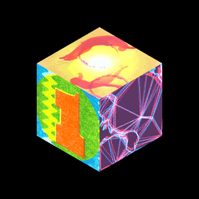 | 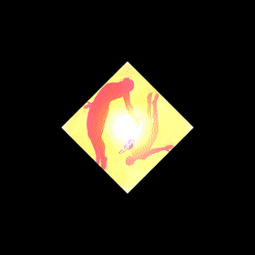 | 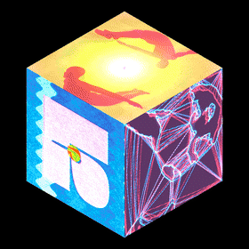 | |

Code: [`scripts/spin_rot.py`](scripts/spin_rot.py), [`shaders/cube_spin.frag`](shaders/cube_spin.frag)

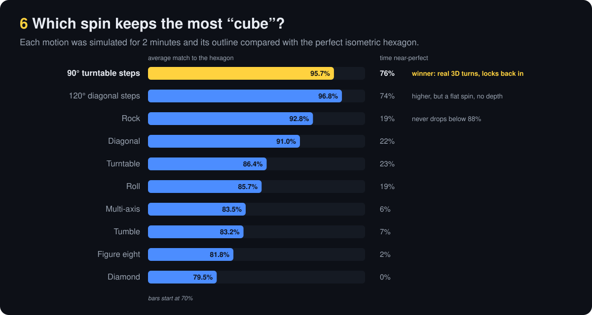
The winner is the one at the top of this page: hold for 4 seconds locked into the corner,
turn 90° in 3 seconds, lock back in. Both simulators are in the repo and run with plain Python:
[`scripts/iso_lab.py`](scripts/iso_lab.py) (how isometric each spin stays) and
[`scripts/axis_lab.py`](scripts/axis_lab.py) (smoothness, jumps, faces seen).

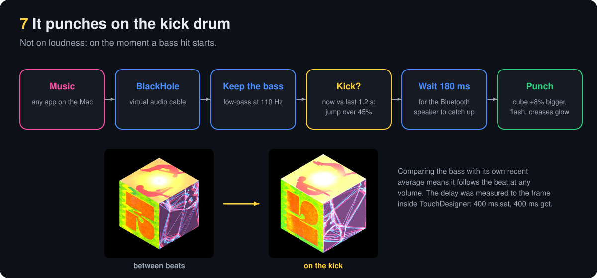
Code: [`scripts/kick_sync.py`](scripts/kick_sync.py)

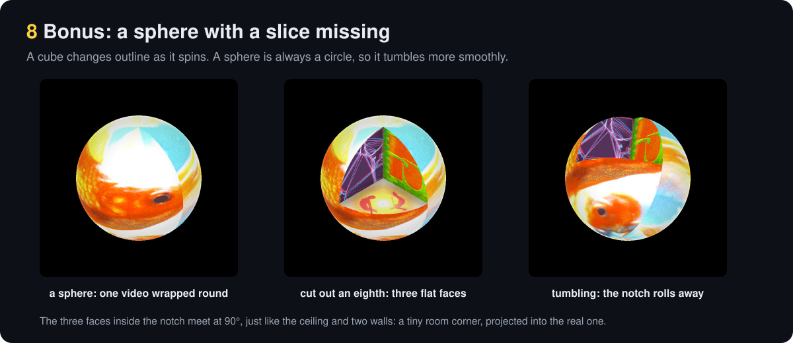
Code: [`shaders/sphere_cut.frag`](shaders/sphere_cut.frag)

---

## The parts

| | |
|---|---|
| Projector | HY300, 1280×720, roughly 150–260 lumens. A dark room matters more than a bright projector. |
| Computer | M4 MacBook Air |
| Software | TouchDesigner 2025 (Non-Commercial, which caps images at 1280 px, the same as the projector) |
| Audio | BlackHole 2ch, a free virtual cable that routes the Mac's music into TouchDesigner |

## What's in here

```
shaders/   GLSL fragment shaders: the 4-point cube rig, the spinning 3D cube, the cut sphere, per-face look
scripts/   Python from inside TouchDesigner: motion engine, shuffle deck, kick sync; plus the two simulators
docs/      BUILD-LOG.md (research and every decision along the way), img/ (these diagrams),
           make_diagrams.py (regenerates the diagrams from the same geometry the piece uses)
```

The shaders and scripts are copied out of the TouchDesigner project so they can be read here.
The `.toe` file itself isn't included. Paths inside the scripts point at my local `~/TD-Lab` folder.

## A few things I learned

- **Measure, don't eyeball.** “Edge to edge” turned out to have three causes: borders baked into
  the GIFs, a seam I'd added on purpose, and a one-pixel seam where the graphics card blended
  each face's last pixel with black. Only measuring the pixels along every crease found the last one.
- **The corner is the calibration.** Three creases meeting at a point is a ready-made 3D axis,
  so four points are enough to describe the whole surface.
- **A projector can't make black.** Dark rooms, mostly-dark pictures, and never lighting two
  neighbouring walls brightly at once (they bounce light into each other) do more than brightness.

## Credits

The video loops on the faces are reference GIFs I collected online. They're not included in this
repo and remain their creators' work; any square video loops will play. The isometric
inverse-bilinear mapping is based on Inigo Quilez's `invBilinear`.

## Next

- Hand tracking (MediaPipe): swipe in the air to spin the cube faster.
- Smoother turns: tune the easing and blend between axes, using the simulators to measure each try.
